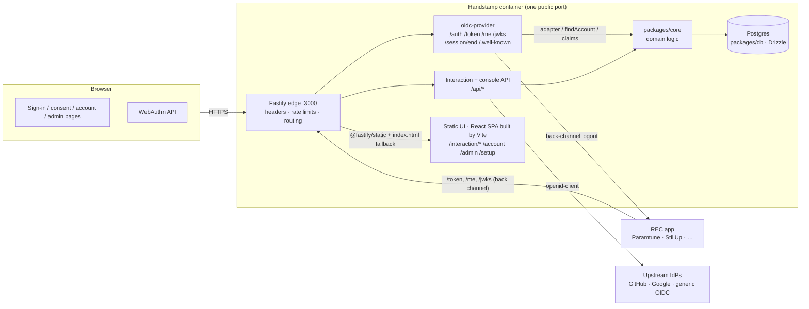
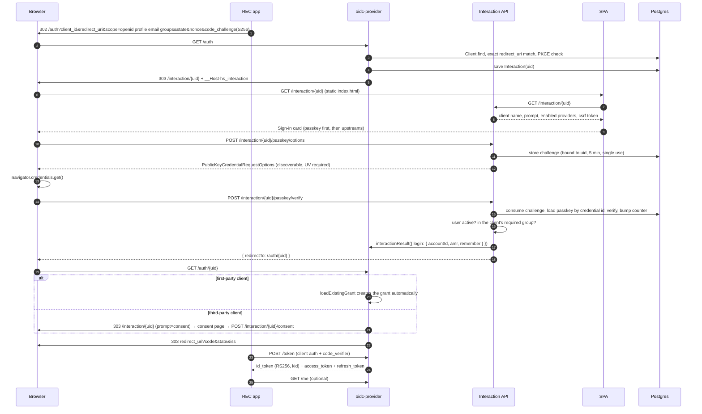
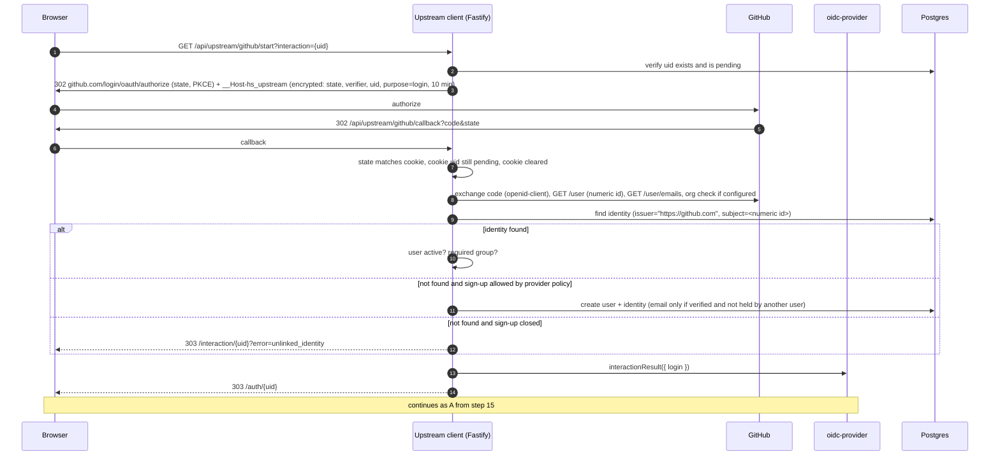
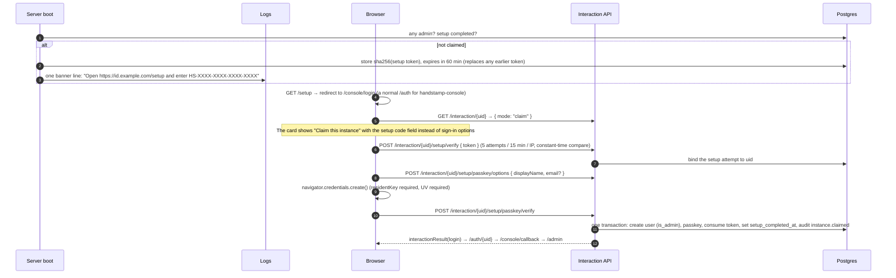

# Handstamp v1 plan

> Status: **M5 done (2026-10-03).** v1 scope complete: passkeys, upstream sign-in, recovery, the account page and admin console, a production image and compose file, deploy/integration/security docs, and full Basic OP + Config OP conformance. Remaining: Paramtune's side of the §6 example (Paramtune work) and running the CI workflows once the repo is on GitHub.
> Handstamp is the passwordless OpenID Connect provider for the R.E.C. product family (RECIAM SAS).
> Siblings: Paramtune (config and schema management), StillUp (API uptime monitoring).

## 0. Summary of decisions and pushback

These are the decisions most worth reviewing. Each is explained in the section it links to.

| #   | Decision                                                                                                                                                                                                                                                                                                                                                    | Why                                                                                                                                                                                                                      |
| --- | ----------------------------------------------------------------------------------------------------------------------------------------------------------------------------------------------------------------------------------------------------------------------------------------------------------------------------------------------------------- | ------------------------------------------------------------------------------------------------------------------------------------------------------------------------------------------------------------------------ |
| D1  | **One Fastify process on one port.** It mounts `oidc-provider`, serves `/api/*`, and serves the UI: a React SPA built with Vite, as static files. There is no Next.                                                                                                                                                                                         | The protocol endpoints reach `oidc-provider` untouched, the UI has no need for server rendering, and there is no second process or internal proxy. See [§1.2](#12-single-origin-one-fastify-process-serving-a-vite-spa). |
| D2  | **Handstamp's own account and admin UI is an OIDC client of itself** (a built-in `handstamp-console` client).                                                                                                                                                                                                                                               | We get one login UI, step-up through `max_age`, and "sign out everywhere" that also kills the console. We never read `oidc-provider` session internals. See [§1.3](#13-how-the-console-authenticates).                   |
| D3  | **PKCE is required by default and can be switched off per client.** It is on for every real client and off only for the conformance suite's test clients, if the suite needs that.                                                                                                                                                                          | The Basic OP plan may send requests without PKCE. To be confirmed in M1. See [§4](#4-security-checklist).                                                                                                                |
| D4  | **`__Host-` cookies for every cookie we name.** For `oidc-provider`'s path-scoped interaction cookies we force `path=/`, and fall back to `__Secure-` if the library refuses.                                                                                                                                                                               | `__Host-` requires `Path=/`, but `oidc-provider` scopes `_interaction` to `/interaction/:uid`. To be confirmed in M1.                                                                                                    |
| D5  | **Client secrets are stored encrypted (AES-256-GCM), not hashed.** They are shown once, at creation or rotation.                                                                                                                                                                                                                                            | `oidc-provider` compares the plaintext secret for `client_secret_basic` and `client_secret_post`, and has no hook for hashed secrets.                                                                                    |
| D6  | **`groups` goes in the ID token (and userinfo) when the `groups` scope is granted. `profile` and `email` claims stay in userinfo only**, the spec default. _(Revised in M1: the first draft put every scope claim in the ID token, which the conformance suite flags under OIDC Core 5.4 because it exposes the email to anyone the ID token is shown to.)_ | The brief asks for `groups` in the ID token. Everything else follows the spec and shares less.                                                                                                                           |
| D7  | **Instance settings come from environment variables. Clients, groups and upstream providers live in the database** and are managed in the admin UI. Env vars can seed upstream providers, and `HANDSTAMP_CLIENTS_FILE` can declare clients. Seeded providers and declared clients are read-only in the UI.                                                  | "Everything through env" doesn't scale to clients created at runtime, but deploys should still be reproducible. See [§8](#8-resolved-decisions) R6.                                                                      |
| D8  | **Invite-only by default.** Self sign-up is opt-in per upstream provider, with an email-domain or GitHub-org allowlist.                                                                                                                                                                                                                                     | An open IdP lets anyone create an account in every app that trusts it. See R2.                                                                                                                                           |
| D9  | **The wordmark is live text in Archivo for now, with a TODO.**                                                                                                                                                                                                                                                                                              | DESIGN §2.9 forbids live-text wordmarks, but the outlined asset has to come from `rec-brand/build.py`, which is out of scope here.                                                                                       |
| D10 | **v1 runs as a single replica.** Rate limits are in memory. Key changes are picked up by polling, so going multi-replica later needs no redesign.                                                                                                                                                                                                           | This keeps v1 small. See R5.                                                                                                                                                                                             |

---

## 1. Architecture

### 1.1 Components



| Path                                                                                                                                                                                              | Owner                       | Notes                                                                                                                                                             |
| ------------------------------------------------------------------------------------------------------------------------------------------------------------------------------------------------- | --------------------------- | ----------------------------------------------------------------------------------------------------------------------------------------------------------------- |
| `/.well-known/openid-configuration`, `/jwks`, `/auth`, `/auth/:uid`, `/token`, `/me`, `/token/revocation`, `/token/introspection`, `/session/end`, `/session/end/confirm`, `/session/end/success` | `oidc-provider`             | Mounted at the root so the issuer is a bare origin. The body is passed through unparsed.                                                                          |
| `/interaction/:uid/*` (e.g. `/details`, `/dev-login`, `/consent`, `/abort`)                                                                                                                       | Fastify (interaction API)   | JSON. CSRF-checked. Rate-limited. It lives under the interaction path because `oidc-provider` scopes its interaction cookie to `/interaction/:uid` (found in M1). |
| `/api/upstream/:provider/{start,callback}`                                                                                                                                                        | Fastify                     | Upstream OAuth/OIDC client, via `openid-client`.                                                                                                                  |
| `/api/me/*`, `/api/admin/*`                                                                                                                                                                       | Fastify (console API)       | Requires the console session cookie.                                                                                                                              |
| `/console/callback`, `/console/logout`                                                                                                                                                            | Fastify                     | The console's own OIDC client callback.                                                                                                                           |
| `/healthz`, `/readyz`                                                                                                                                                                             | Fastify                     | Not rate-limited. No database details in the response.                                                                                                            |
| `/assets/*`                                                                                                                                                                                       | Fastify (`@fastify/static`) | Hashed Vite build output, `Cache-Control: immutable`.                                                                                                             |
| UI routes: `/interaction/:uid`, `/setup`, `/account/*`, `/admin/*`, `/logout`, `/error`                                                                                                           | Fastify (SPA fallback)      | Returns `index.html` with `no-store`. The SPA reads and writes only through `/api/*`. Unknown paths outside this list return 404.                                 |

Every route is in this explicit table. There is no catch-all, so a typo'd protocol path 404s instead of silently returning the SPA.

### 1.2 Single origin: one Fastify process serving a Vite SPA

**Choice:** one Node process, one public port.

- **Fastify** listens on `PORT` (default 3000). It mounts `oidc-provider`, the JSON API and the static UI. Rate limits, `trustProxy`, security headers and log redaction sit in one place, in front of everything.
- **The UI** is a React 19 SPA built by Vite (`apps/web` → `apps/web/dist`), with Tailwind v4 via `@tailwindcss/vite`, lucide-react and React Router 7 in library mode. Data goes through small `fetch` wrappers over `/api/*`. No server rendering.
- **Code splitting:** the sign-in, consent, claim and logout pages are one small chunk. The account and admin console is a separate chunk that the sign-in page never loads.
- **Auth gating** happens in the API: console routes return 401 and the SPA redirects to `/console/login`. The UI shell itself holds no data.
- **CSP:** a static bundle runs under `script-src 'self'` plus one hash for the inline theme script (DESIGN §14.2), with no per-request nonces.
- **Local development:** `pnpm dev` runs one Fastify process that loads Vite in middleware mode (`@fastify/middie`), so dev is also one process on one origin, and cookies, WebAuthn and redirects behave as in production.
- **Production build:** esbuild bundles the server, the CLI and the migrator into plain ESM in `apps/server/dist` (`apps/server/build.mjs`). The image is Alpine plus the Node binary and the two `dist` folders: no npm, pnpm, tsx or `node_modules`. Against the previous Debian image that runs TypeScript through tsx, it is 205 MB instead of 644 MB (55 MB instead of 138 MB compressed), ready in 0.5 s instead of 1.2 s, and uses about 100 MiB of memory instead of 300 MiB. See R19.

**Why not Next?** Nothing here needs server rendering or SEO: every page is a sign-in card or sits behind sign-in, and passkeys need JavaScript anyway. Next would mean either a second process with an internal proxy, or Next's custom-server API. Paramtune has since moved to the same Vite + React Router setup. The React components and the Tailwind tokens carry over unchanged either way.

**Why not put the UI in front (the StillUp model)?** `/token`, `/auth` and `/session/end` need exact headers, `WWW-Authenticate`, form bodies, redirects and cookies. A proxy in an app framework rewrites or buffers them.

### 1.3 How the console authenticates

`/account` and `/admin` are served by a built-in, non-deletable, confidential, first-party client called `handstamp-console`. Its secret is derived from `HANDSTAMP_SECRET_KEY` with HKDF.

1. When there is no console session, the API returns 401 and the SPA redirects to `/console/login`. That starts a normal `/auth` request with PKCE.
2. After the user signs in, `/console/callback` exchanges the code. It then sets `__Host-hs_console`, an encrypted cookie holding `{ sub, sid, auth_time, amr, exp }`.
3. On every `/api/me/*` and `/api/admin/*` request, Fastify checks that the OP session `sid` still exists. Signing out everywhere or revoking a session from the admin UI therefore also kills the console immediately.
4. **Step-up:** a sensitive action (link or unlink an identity, add or remove a passkey, mint a recovery link, rotate keys, edit a client) needs `auth_time` within the last 5 minutes. If it's older, the UI restarts `/auth` with `max_age=0` and the action resumes afterwards.

### 1.4 Request flows

#### A. A REC app signs a user in with a passkey



#### B. A REC app signs a user in through GitHub

The flow is the same as A up to the sign-in card. Then:



An email match **never** links accounts. If the GitHub identity is unknown and sign-up is closed, the card says:
_"This GitHub account isn't connected to Handstamp yet. Sign in another way and link it from your account page, or ask your admin for an invite."_ The message is the same whether or not the email exists in Handstamp.

#### C. First-run setup



- The setup token is the **only** secret Handstamp ever logs. It is written once, by a dedicated logger outside request logging. It expires after 60 minutes, and a restart issues a new one.
- After the instance is claimed, `/setup` shows "This instance already has an admin." and stops accepting codes.
- If upstream providers are seeded from env, the claimant may use one of them instead of a passkey. Recovery still nudges them to add a passkey.

#### D. Logout

```mermaid
sequenceDiagram
  autonumber
  participant RP as REC app
  participant B as Browser
  participant OP as oidc-provider
  participant N as SPA
  participant RPs as Other RPs (backchannel_logout_uri)
  RP->>B: 302 /session/end?id_token_hint&post_logout_redirect_uri&state&client_id
  B->>OP: GET /session/end
  OP->>OP: validate hint, exact-match post_logout_redirect_uri
  OP->>B: logoutSource → 303 /logout + __Host-hs_logout (xsrf, client name; 5 min)
  B->>N: GET /logout → "Sign out of Paramtune?" (+ "Also sign out of Handstamp", checked by default)
  B->>OP: POST /session/end/confirm (xsrf, logout=yes|no)
  OP->>RPs: POST logout_token (sub, sid, events) to each client in this session
  OP->>B: 303 post_logout_redirect_uri?state  (or /session/end/success → branded page)
```

**Sign out everywhere** (account page) and **revoke session** (admin) work the same way. They destroy every `Session` payload for the account, revoke every grant (access and refresh tokens), and call back-channel logout for each `(client, sid)`. They also write an audit event.

---

## 2. Data model and adapter

Everything below lives in `packages/db/src/schema.ts` (Drizzle). IDs are UUIDv4 unless noted. All timestamps are `timestamptz`.

### 2.1 Tables

| Table                 | Columns (main ones)                                                                                                                                                                                                                                                                                                                                                                                                                                                                                                            | Keys and indexes                                                                                                                 |
| --------------------- | ------------------------------------------------------------------------------------------------------------------------------------------------------------------------------------------------------------------------------------------------------------------------------------------------------------------------------------------------------------------------------------------------------------------------------------------------------------------------------------------------------------------------------ | -------------------------------------------------------------------------------------------------------------------------------- |
| `users`               | `id uuid` (**this is `sub`**: random and opaque, never reused), `display_name`, `preferred_username citext null`, `email citext null`, `email_verified bool`, `email_identity_id uuid null` (which identity vouched for the email), `picture_url null`, `webauthn_user_handle bytea` (64 random bytes, not `sub`), `is_admin bool`, `status enum(active, disabled)`, `created_at`, `last_sign_in_at`                                                                                                                           | PK `id` · UNIQUE `preferred_username` · UNIQUE `webauthn_user_handle` · **partial UNIQUE `lower(email)` WHERE `email_verified`** |
| `identities`          | `id`, `user_id → users ON DELETE CASCADE`, `provider_id → upstream_providers ON DELETE RESTRICT`, `issuer text`, `subject text`, `email`, `email_verified`, `login_hint` (e.g. the GitHub login, for display only), `linked_at`, `last_used_at`                                                                                                                                                                                                                                                                                | PK `id` · **UNIQUE `(issuer, subject)`** · IDX `user_id`                                                                         |
| `passkeys`            | `id`, `user_id → users CASCADE`, `credential_id bytea`, `public_key bytea`, `sign_count bigint`, `transports text[]`, `aaguid uuid`, `device_type enum(single_device, multi_device)`, `backed_up bool`, `name`, `created_at`, `last_used_at`                                                                                                                                                                                                                                                                                   | PK `id` · **UNIQUE `credential_id`** · IDX `user_id`                                                                             |
| `webauthn_challenges` | `id`, `challenge bytea`, `purpose enum(authenticate, register, setup, step_up)`, `user_id null`, `interaction_uid null`, `expires_at`, `consumed_at`                                                                                                                                                                                                                                                                                                                                                                           | PK `id` · IDX `interaction_uid` · IDX `expires_at`                                                                               |
| `groups`              | `id`, `slug text` (the claim value, `^[a-z0-9][a-z0-9._:-]{0,63}$`), `name`, `description`, `created_at`                                                                                                                                                                                                                                                                                                                                                                                                                       | PK · UNIQUE `slug`                                                                                                               |
| `group_members`       | `group_id → groups CASCADE`, `user_id → users CASCADE`, `added_by`, `added_at`                                                                                                                                                                                                                                                                                                                                                                                                                                                 | PK `(group_id, user_id)` · IDX `user_id`                                                                                         |
| `oidc_clients`        | `client_id text` (operator-chosen slug, e.g. `paramtune`), `source enum(db, file, builtin)`, `name`, `client_secret_enc bytea null` (null means public client), `token_endpoint_auth_method`, `redirect_uris text[]`, `post_logout_redirect_uris text[]`, `allowed_scopes text[]`, `grant_types text[]`, `first_party bool`, `require_pkce bool default true`, `backchannel_logout_uri null`, `required_group_id null → groups SET NULL`, `enabled`, `builtin bool` (console), `secret_rotated_at`, `created_at`, `updated_at` | PK `client_id` · IDX `enabled`                                                                                                   |
| `upstream_providers`  | `id`, `slug`, `kind enum(github, google, oidc)`, `display_name`, `issuer text` (`https://github.com` for GitHub), `client_id`, `client_secret_enc`, `scopes text[]`, `allow_signup bool`, `allowed_email_domains text[]`, `github_allowed_orgs text[]`, `trust_email_verified bool`, `enabled`, `source enum(env, db)`, `sort_order`                                                                                                                                                                                           | PK · UNIQUE `slug` · UNIQUE `issuer` WHERE `enabled`                                                                             |
| `signing_keys`        | `kid text`, `alg text`, `private_jwk_enc bytea`, `public_jwk jsonb`, `state enum(staged, active, retiring, retired)`, `created_at`, `activated_at`, `retire_after`, `retired_at`                                                                                                                                                                                                                                                                                                                                               | PK `kid` · **partial UNIQUE `(alg)` WHERE `state='active'`**                                                                     |
| `cookie_keys`         | `id`, `key_enc bytea`, `state enum(active, retiring, retired)`, `created_at`                                                                                                                                                                                                                                                                                                                                                                                                                                                   | PK                                                                                                                               |
| `enrollment_tokens`   | `id`, `token_hash bytea` (sha256), `purpose enum(setup, invite, recovery)`, `user_id null` (recovery), `preset_group_ids uuid[]` (invites), `revoke_other_sessions bool`, `created_by null`, `expires_at`, `consumed_at`, `consumed_by_user_id`                                                                                                                                                                                                                                                                                | PK · UNIQUE `token_hash` · IDX `(purpose, expires_at)`                                                                           |
| `oidc_payloads`       | see §2.2                                                                                                                                                                                                                                                                                                                                                                                                                                                                                                                       |                                                                                                                                  |
| `session_meta`        | `sid text` (OP session uid), `user_id`, `created_at`, `last_seen_at`, `user_agent` (parsed summary), `ip_prefix inet` (/24 for v4, /48 for v6), `amr text[]`                                                                                                                                                                                                                                                                                                                                                                   | PK `sid` · IDX `user_id`                                                                                                         |
| `audit_log`           | `id bigserial`, `at`, `actor_type enum(user, admin, system, cli)`, `actor_user_id null`, `action text` (e.g. `auth.sign_in.succeeded`, `client.secret.rotated`), `target_type`, `target_id`, `client_id null`, `ip_prefix`, `user_agent`, `metadata jsonb` (allowlisted fields only, never secrets)                                                                                                                                                                                                                            | PK · IDX `at DESC` · IDX `(actor_user_id, at)` · IDX `(target_type, target_id, at)` · IDX `(action, at)`                         |
| `instance_settings`   | singleton: `instance_name`, `setup_completed_at`, `require_two_methods bool`, `updated_at`                                                                                                                                                                                                                                                                                                                                                                                                                                     | PK `id = 1` CHECK                                                                                                                |

Notes:

- **No password, OTP or shared-secret column exists for humans.** A CI check rejects columns named `*password*`, `*otp*` and `*totp*`.
- Email uniqueness is enforced **only among verified emails**. This protects relying parties that wrongly key users by email: two Handstamp users can never both present `alice@x.com` with `email_verified: true`. When an upstream sign-up asserts a verified email that another user already holds, the new account gets no email claim, and we write an audit event `user.email_conflict`.
- `audit_log` is append-only from the application. The only delete is the retention job (`AUDIT_RETENTION_DAYS`, default 365).

### 2.2 `oidc-provider` adapter strategy

We use one generic table, following panva's reference adapters, with extracted columns for the lookups that `oidc-provider` and the console need:

```
oidc_payloads(
  kind text,            -- Session, Interaction, AuthorizationCode, AccessToken, RefreshToken, Grant, ...
  id text,
  payload jsonb,
  grant_id text null,   -- revokeByGrantId
  uid text null,        -- findByUid (Session, Interaction)
  user_code text null,  -- unused (no device flow), kept for adapter completeness
  account_id text null, -- list sessions/grants per user, sign out everywhere
  expires_at timestamptz null,
  consumed_at timestamptz null,
  PRIMARY KEY (kind, id)
)
INDEX (grant_id) WHERE grant_id IS NOT NULL
INDEX (kind, uid) WHERE uid IS NOT NULL
INDEX (kind, account_id) WHERE account_id IS NOT NULL
INDEX (expires_at)
```

- **`Client` is the exception.** Its adapter `find(id)` reads `oidc_clients`, decrypts the secret and maps the row to client metadata. It returns `undefined` when the client is disabled. Writes are refused, because there is no dynamic registration.
- `find` returns nothing for expired rows, regardless of the sweeper. `consume` sets `consumed_at`. Refresh-token reuse is handled by `oidc-provider`: using a consumed refresh token revokes the grant. An M1 test checks this.
- A **sweeper** runs every 10 minutes under `pg_try_advisory_lock`. It deletes expired payloads, challenges and enrollment tokens, and trims the audit log.
- **Client cache:** when an admin edits a client, we tell the provider so it re-instantiates that client. M1 verifies how `oidc-provider` caches clients. If invalidating one entry isn't possible, we rebuild the provider (§2.3), which is cheap because all state is in Postgres.

### 2.3 Signing keys and rotation with overlap

- The default algorithm is **RS256** (mandatory to implement for OPs, and supported by every RP library). ES256 can be enabled with `HANDSTAMP_ID_TOKEN_ALGS`. HS* algorithms are disabled, so no ID token is ever signed with a client secret.
- Private JWKs are encrypted with a key derived from `HANDSTAMP_SECRET_KEY` (HKDF, `info="signing-keys"`).
- **Lifecycle:** `staged` (published in JWKS, not used for signing) → `active` (signs) → `retiring` (published, not signing) → `retired` (unpublished, private key wiped).
  1. `handstamp keys rotate`, or the admin UI, creates a **staged** key, so RPs can cache it before it signs anything.
  2. After `KEY_STAGE_HOURS` (default 24), the scheduler promotes staged to **active** and moves the old active key to **retiring**.
  3. Retiring keys stay published for `max(ID token TTL, logout token TTL) + 1h` (default 2h), then become **retired**.
  4. Automatic rotation runs every `KEY_ROTATION_DAYS` (default 90; `0` turns it off).
- **Nobody is logged out.** Sessions, refresh tokens and access tokens are opaque rows in Postgres, not JWTs signed with these keys. Only ID tokens and logout tokens are signed, and RPs check them once.
- `oidc-provider` takes `jwks` at construction. On a key state change, the server builds a new `Provider` and swaps the handler reference atomically. Every process polls the key set every 60 seconds and rebuilds when it changed, which also picks up changes made by the CLI.
- Cookie-signing keys rotate the same way (`[active, retiring]` keygrip list).

---

## 3. Account linking and recovery

### 3.1 Identity rules

1. **A sign-in identity is `(issuer, subject)`**, and nothing else. GitHub is OAuth2, not OIDC, so its identity is `("https://github.com", <numeric user id>)`, never the login, which users can rename.
2. **Email is a claim, not a key.** We never look users up by email when signing in or linking.
3. **Linking a second identity needs an authenticated console session**, with step-up done in the last 5 minutes (§1.3). The `link` purpose and the user's `sub` and `sid` go in the encrypted upstream state cookie. The callback checks that the console session still matches.
4. If the `(issuer, subject)` already belongs to **another** user, linking is refused ("That GitHub account is already connected to a different Handstamp account."). Accounts are never merged, and an admin has to resolve it.
5. Invites (`enrollment_tokens.purpose = invite`) let a new person register their first passkey or link their first upstream identity, even when sign-up is closed.
6. Generic OIDC providers have `trust_email_verified = false` by default. In that case `email_verified` from the upstream is stored but never passed on to RPs.

### 3.2 Recovery model (proposal)

Three layers, from the most common case to the last resort:

| Layer                      | What                                                                                                                                                                                                                                                                                                                                                                                                                                                                                                                                     | Trade-off                                                                                                                                                                                                   |
| -------------------------- | ---------------------------------------------------------------------------------------------------------------------------------------------------------------------------------------------------------------------------------------------------------------------------------------------------------------------------------------------------------------------------------------------------------------------------------------------------------------------------------------------------------------------------------------- | ----------------------------------------------------------------------------------------------------------------------------------------------------------------------------------------------------------- |
| **1. Multiple methods**    | The account page asks people to add a second method (another passkey, or an upstream identity) and shows a persistent banner until they do. Synced passkeys (`backed_up = true`) count as backed up and tone the banner down. Operators can make it **required** (`require_two_methods`): then, after the first sign-in, the user has to add a second method before going on to the RP. You can never remove your last method.                                                                                                           | A hard requirement adds friction at first sign-in, and some users only own one device. That's why it's a nudge by default (R3).                                                                             |
| **2. Admin recovery link** | An admin (with step-up) creates a single-use link for a user: 32 random bytes, stored as a sha256 hash, valid for 30 minutes by default. Opening it **does not sign anyone in by itself**. It lands on a card that requires registering a new passkey (or linking an upstream identity) first, and only then creates a session. The admin chooses whether to revoke the user's other sessions and passkeys, which is the default for "I lost my device". The admin hands the link over out of band. Handstamp sends no email in v1 (R4). | It relies on the admin checking who they're talking to. The audit log records who created the link, who used it, when, and the IP prefix. The user sees a "Recovery link used" event on their account page. |
| **3. Break-glass CLI**     | `docker exec handstamp handstamp recovery issue --user <sub or email>` prints a recovery link. This covers the lone admin who lost every method.                                                                                                                                                                                                                                                                                                                                                                                         | Shell access to the host is already the root of trust (it holds `HANDSTAMP_SECRET_KEY` and the database). It is audited as `actor_type=cli`.                                                                |

Guardrails: the last admin can't be demoted, disabled or deleted, and nobody can remove their own last sign-in method.

### 3.3 Threats

| Threat                                                                                                                              | Mitigations                                                                                                                                                                                                                                                                                                                                                                                                                                                                                                          |
| ----------------------------------------------------------------------------------------------------------------------------------- | -------------------------------------------------------------------------------------------------------------------------------------------------------------------------------------------------------------------------------------------------------------------------------------------------------------------------------------------------------------------------------------------------------------------------------------------------------------------------------------------------------------------- |
| **Account takeover via email.** The attacker controls an upstream account (or a sloppy generic IdP) that claims the victim's email. | Never link by email (§3.1). Verified-email uniqueness (§2.1). `trust_email_verified` off for generic issuers. Sign-up closed by default. The unknown-identity error is identical whether or not the email exists. The integration guide tells RPs to key on `(iss, sub)` and turn off email-based linking (§6).                                                                                                                                                                                                      |
| **Lost passkey.**                                                                                                                   | Layer 1 (second method), Layer 2 (admin link), Layer 3 (CLI). Sessions on other devices keep working until they're revoked. A recovery link can revoke the lost device's passkey and sessions in the same step.                                                                                                                                                                                                                                                                                                      |
| **Compromised upstream account.** An attacker signs in to Handstamp as the victim through their GitHub.                             | The attacker can only reach RPs, not change the account: adding or removing methods needs step-up, which goes to a **passkey when the user has one**. The account page lists sessions with sign-in method and time. The user or an admin can unlink the identity or disable it per user. Admins can disable a provider instance-wide. The `amr` claim tells RPs how the user signed in: present for passkeys, absent for federated sign-ins (R11). Letting RPs demand a passkey through `acr_values` comes after v1. |
| **Stolen session cookie.**                                                                                                          | `__Host-`, `HttpOnly`, `Secure`, `SameSite=Lax`. Idle timeout 24h and absolute lifetime 14 days (env). Step-up for sensitive actions. Session list with revoke. Sign out everywhere also sends back-channel logout to RPs. Admins can revoke any session.                                                                                                                                                                                                                                                            |
| **Stolen refresh token.**                                                                                                           | Rotation on every use. Reusing a consumed refresh token revokes the whole grant. Refresh tokens die with the user being disabled, the client being disabled, or sign-out-everywhere.                                                                                                                                                                                                                                                                                                                                 |
| **Code interception / injection.**                                                                                                  | PKCE S256 required. Codes live 60s and are single use. `iss` comes back in the authorization response (RFC 9207). Redirect URIs must match exactly.                                                                                                                                                                                                                                                                                                                                                                  |
| **Malicious admin, or a stolen admin session.**                                                                                     | Step-up on every admin mutation. Everything is audited. Client secrets can't be read back after creation. The admin can't read users' private keys or tokens.                                                                                                                                                                                                                                                                                                                                                        |
| **Setup token race** (someone else claims a fresh instance first).                                                                  | The token is only in the logs. It's rate-limited, expires after 60 minutes, and claiming is a single atomic transaction. The docs say to claim the instance before exposing it publicly.                                                                                                                                                                                                                                                                                                                             |

---

## 4. Security checklist

Every item points to the file that will own it, and has a test. Paths are relative to the repo root.

| #   | Control                                                                                                                                                                                                                                                                          | Code location                                                                                       | Test                                                                                                                |
| --- | -------------------------------------------------------------------------------------------------------------------------------------------------------------------------------------------------------------------------------------------------------------------------------- | --------------------------------------------------------------------------------------------------- | ------------------------------------------------------------------------------------------------------------------- |
| S1  | PKCE S256 required (per-client `require_pkce`, default true; `plain` disallowed)                                                                                                                                                                                                 | `apps/server/src/oidc/config.ts` → `pkce.required`                                                  | `apps/server/test/oidc.pkce.test.ts`                                                                                |
| S2  | Exact-match `redirect_uris` and `post_logout_redirect_uris`. No wildcards. `https` only, except loopback (`http://localhost`, `*.localhost`, `127.0.0.1`, `[::1]`)                                                                                                               | `packages/core/src/clients/validate.ts` + `oidc-provider`                                           | `packages/core/src/clients/validate.test.ts`                                                                        |
| S3  | Code TTL 60s, single use. Access token 10m. ID token 1h. Refresh token 14d, rotating, with reuse detection                                                                                                                                                                       | `apps/server/src/oidc/ttl.ts`                                                                       | `oidc.tokens.test.ts`                                                                                               |
| S4  | `__Host-` session cookie (`__Secure-` for the path-scoped interaction cookies), `Secure`, `HttpOnly`, signed with rotating keys. Interaction cookies `SameSite=Lax`; the SSO session cookie `SameSite=None` on https issuers so POST to `/auth` works (R16)                      | `apps/server/src/oidc/provider.ts` (`cookies`, `cookieNames`)                                       | `oidc.flow.test.ts` (cookie attributes) + conformance `oidcc-ensure-post-request-succeeds`                          |
| S5  | CSRF on interaction and console APIs: `Origin` must equal the issuer origin, plus a double-submit token tied to the interaction uid or console session                                                                                                                           | `apps/server/src/http/csrf.ts`                                                                      | `csrf.test.ts`                                                                                                      |
| S6  | Upstream `state`, `nonce` and PKCE in an encrypted 10-minute cookie, bound to the interaction uid and cleared on use                                                                                                                                                             | `apps/server/src/upstream/state.ts`                                                                 | `upstream.state.test.ts`                                                                                            |
| S7  | Rate limits: `/token` (per client and IP), `/interaction/:uid/*` (per IP and per uid), setup verify (5 per 15 min), recovery-link redeem, upstream callback                                                                                                                      | `apps/server/src/http/rate-limit.ts` (`@fastify/rate-limit`)                                        | `rate-limit.test.ts`                                                                                                |
| S8  | No open redirects: every internal `returnTo` goes through `safeReturnPath()` (relative path only, no `//`, no backslash). Only `oidc-provider` redirects to RPs                                                                                                                  | `packages/core/src/http/safe-return.ts`                                                             | `safe-return.test.ts` (fuzz cases)                                                                                  |
| S9  | Secrets never logged: pino `redact` covers `authorization`, `cookie`, `set-cookie`, `client_secret`, `code`, `code_verifier`, `refresh_token`, `id_token_hint`, `token` and query strings on `/token` and callbacks. The setup banner is the only exception                      | `apps/server/src/log.ts`                                                                            | `log.redact.test.ts` (snapshot of log output)                                                                       |
| S10 | Secrets at rest: client secrets, upstream secrets, signing and cookie keys encrypted with AES-256-GCM under HKDF subkeys of `HANDSTAMP_SECRET_KEY`. Startup refuses a missing or short key                                                                                       | `packages/core/src/crypto/envelope.ts`, `apps/server/src/env.ts`                                    | `envelope.test.ts`, `env.test.ts`                                                                                   |
| S11 | Tokens stored hashed: enrollment and setup tokens as sha256, compared in constant time                                                                                                                                                                                           | `packages/core/src/enrollment.ts`                                                                   | `enrollment.test.ts`                                                                                                |
| S12 | WebAuthn: RP ID = issuer host. Expected origin = issuer origin. `userVerification: required`, discoverable credentials required. Challenges single use, 5 min, bound to the interaction or console session. A counter that goes backwards is refused (synced passkeys stay at 0) | `packages/core/src/passkeys.ts`, `apps/server/src/passkeys.ts`                                      | `apps/server/test/passkeys.flow.test.ts` (phishing origin, replayed challenge, counter regression, unknown passkey) |
| S13 | Identity keyed by `(issuer, subject)`. No email lookup in sign-in or linking code paths                                                                                                                                                                                          | `packages/core/src/identities.ts`                                                                   | `identities.test.ts` + a lint rule banning `users.email` in `upstream/**`                                           |
| S14 | Step-up (`auth_time` ≤ 5 min) before adding or removing passkeys; sign out everywhere deliberately needs none                                                                                                                                                                    | `apps/server/src/console/session.ts` (`recentlyAuthenticated`), `apps/server/src/console/routes.ts` | `passkeys.flow.test.ts` (step-up)                                                                                   |
| S15 | Security headers: strict CSP (`script-src 'self'` + theme-script hash), `frame-ancestors 'none'`, HSTS, `Referrer-Policy: no-referrer` on interaction pages, `X-Content-Type-Options`                                                                                            | `apps/server/src/http/headers.ts`                                                                   | `headers.test.ts`                                                                                                   |
| S16 | `trustProxy` set from `TRUST_PROXY` (hop count or CIDR), never `true`. `provider.proxy = true` only when it is set                                                                                                                                                               | `apps/server/src/env.ts`, `apps/server/src/oidc/provider.ts`                                        | `env.test.ts`                                                                                                       |
| S17 | Dev login refused when `NODE_ENV=production`, unless `HANDSTAMP_CONFORMANCE_MODE=1` and the issuer host is `localhost`, `*.test` or `*.localhost`                                                                                                                                | `apps/server/src/dev/test-account.ts`                                                               | `test-account.test.ts`                                                                                              |
| S18 | Disabled user or client: `findAccount` returns undefined, grants and sessions revoked, back-channel logout sent                                                                                                                                                                  | `packages/core/src/users.ts`, `apps/server/src/oidc/account.ts`                                     | `disable.test.ts`                                                                                                   |
| S19 | Audit log covers sign-ins (success, failure, refusal and reason), method changes, every admin change (attributed to the admin), key rotation and recovery, with no secrets in `metadata`                                                                                         | `packages/core/src/audit.ts` (typed action union), `apps/server/src/admin/routes.ts`                | `admin.flow.test.ts` ("records every admin change")                                                                 |
| S20 | Error pages reflect no user input. `renderError` maps to fixed codes                                                                                                                                                                                                             | `apps/server/src/oidc/errors.ts`, `apps/web/app/error/page.tsx`                                     | `errors.test.ts`                                                                                                    |
| S21 | Dependency hygiene: `oidc-provider`, `openid-client` and `@simplewebauthn/*` pinned exactly. `pnpm audit` in CI                                                                                                                                                                  | `package.json`, `.github/workflows/ci.yml`                                                          | CI                                                                                                                  |

---

## 5. Repository layout and milestones

### 5.1 Layout

```
handstamp/
├── apps/
│   ├── server/          @handstamp/server  Fastify edge, oidc-provider, /api/*, CLI (src/cli.ts)
│   └── web/             @handstamp/web     Vite + React SPA (interaction, setup, account, admin)
├── packages/
│   ├── core/            @handstamp/core    domain logic: users, identities, passkeys, groups,
│   │                                       clients, enrollment, audit, crypto. No Fastify/React/Koa.
│   └── db/              @handstamp/db      Drizzle schema, migrations, oidc adapter (storage only)
├── conformance/         OIDF suite compose file, test-plan configs, runner script
├── docs/                PLAN.md, INTEGRATING.md, DEPLOYING.md (Dokploy), SECURITY.md
├── Dockerfile · compose.yaml · .env.example · CLAUDE.md
```

The tooling matches StillUp: pnpm workspace, Node ≥ 24, ESM, TypeScript 6, Prettier (`singleQuote`, `trailingComma: all`, `printWidth: 100`), Vitest, Drizzle, Postgres 17. License: Apache-2.0, like StillUp (R9).

### 5.2 Milestones

Each milestone ends with `pnpm check` green, a short demo script in `docs/`, and its tests.

**M1: Protocol skeleton (a dev-only test account passes a conformance smoke test)** · ✅ done

- Monorepo scaffold, `env.ts` with zod validation, `.env.example`, pino with redaction.
- `packages/db`: `oidc_payloads`, `oidc_clients`, `signing_keys`, `cookie_keys`, `users`, `audit_log` (minimal), migrations.
- `oidc-provider` mounted in Fastify, with discovery, JWKS, `/auth`, `/token`, `/me`, refresh, revocation, RP-initiated logout and back-channel logout.
- Vite SPA served by Fastify (§1.2). A bare interaction page and a **"Continue as test user"** button behind `HANDSTAMP_DEV_LOGIN=1` (S17). This is not a password.
- `HANDSTAMP_CLIENTS_FILE` (R6): declarative, read-only clients, used by the conformance setup from day one. Key rotation CLI (`keys rotate`, `keys list`).
- Spikes to settle in the first days, before any UI work: D3 (the suite and PKCE), D4 (interaction cookie path), client-cache invalidation, `Client.backchannelLogout` from outside a request, refresh-token reuse revoking the grant.
- **Exit:** the OIDF suite runs locally through `conformance/run.sh` with the `oidcc-config-certification-test-plan` all passing, plus a smoke subset of `oidcc-basic-certification-test-plan` (`oidcc-server`, `oidcc-refresh-token`, `oidcc-userinfo-get`, `oidcc-ensure-redirect-uri-in-authorization-request`, `oidcc-prompt-login`, `oidcc-max-age-1`, `oidcc-id-token-hint`) passing. The sign-in card can be plain at this stage.

**M2: Passkeys and first-run setup** · ✅ done

- `passkeys` and `webauthn_challenges` tables. Discoverable sign-in, plus conditional UI (autofill) where the browser supports it.
- Setup token flow (§1.4 C) and the console client with its cookie (§1.3).
- Account page v1: profile, passkeys (add, rename, remove; never the last one), sessions, sign out everywhere.
- `/` becomes a redirect (R17): unclaimed instance → `/setup`; signed out → console sign-in; signed in → `/account` (admins also see an **Admin** link).
- Step-up (S14). The sign-in, claim and consent cards fully designed per DESIGN (both themes, 375px to 1536px, §16 checklist).
- Tests: a software authenticator (`apps/server/test/authenticator.ts`: real P-256 keys, CBOR attestation) drives the integration tests, and `pnpm e2e` runs the real UI in Chromium with its virtual WebAuthn authenticator.
- **Exit:** a fresh database plus the setup code gives an admin with a passkey, and the example app (`examples/test-app`) signs in with that passkey. ✅
- **Deviations:** passkey autofill (conditional UI) is not used: sign-in has no username field, so the passkey button does the same job. The session list shows when, how and which apps; device names (user agent) are not recorded yet.

**M3: Upstream providers and linking** · ✅ done

- `upstream_providers` and `identities`. GitHub, Google and generic OIDC through `openid-client`. Seeding from env.
- Sign-up policy (closed, invite, domain or org allowlist), invites, linking from the account page, verified-email uniqueness, conflict handling.
- Recovery layers 1 to 3 (§3.2).
- Tests: a mock upstream OIDC issuer (an `oidc-provider` instance in tests) for login, sign-up, link, conflict and refusal. GitHub is mocked at the HTTP level.
- **Exit:** every threat row in §3.3 has at least one automated test named after it. ✅ Account takeover via email, compromised upstream account and lost passkey are `describe('threat: …')` blocks in `apps/server/test/upstream.flow.test.ts`; stolen session and refresh token live in `passkeys.flow.test.ts` and `oidc.flow.test.ts`; the setup token race is the "cannot be claimed twice" test. The malicious-admin row lands with the admin UI in M4.
- **Built beyond the list:** step-up requires a passkey when the user has one (a fresh upstream sign-in doesn't count), the account page's "Recent security activity", GitHub Enterprise support, `pnpm example:idp` (a demo upstream issuer for local testing), and userinfo fallback for issuers that keep email out of the ID token.
- **Moved:** groups and their claim move to M4, with the admin UI that manages them.

**M4: Admin UI and audit log** · ✅ done

- Admin pages: overview (stat tiles: users, active sessions, clients, providers), users (detail, groups, sessions, identities, disable, recovery link), groups, clients (create, rotate secret, show once, redirect URI editor, first-party flag, required group), upstream providers, signing keys (rotate, state timeline), audit log (filter by actor, action, target and time; CSV export).
- Every admin mutation is audited and needs step-up.
- **Exit:** the §16 checklist passes on every screen in both themes, with screenshots in the PR, and the audit log covers every row of S19. ✅ Screenshots of every admin screen in Dark and Paper (and 375px) come from `SCREENSHOT_DIR=… pnpm e2e`; S19 is the "records every admin change" test in `apps/server/test/admin.flow.test.ts`.
- **Also in M4:** groups and the `groups` claim (from M3); per-app required group (R7) enforced by an extra `access` prompt that runs on every authorization, SSO included, with a "No access to …" card; guardrails (no self-demotion, never zero admins); app secrets generated and shown once (and cleared from browser history); env/file/built-in entries read-only; CSV export neutralises spreadsheet formulas.

**M5: Docker, compose, Dokploy, full conformance and docs** · ✅ done

- One `Dockerfile` (multi-stage, Alpine, non-root, `tini`, one Node process running the bundled server, the built SPA copied in, `HEALTHCHECK` on `/readyz`). `compose.yaml` with the app and `postgres:17-alpine`. Migrations run at start behind an advisory lock.
- `docs/DEPLOYING.md` uses `id.rec.farm` as the worked example of a real deploy (R13).
- `docs/DEPLOYING.md`: Dokploy (Traefik in front, `TRUST_PROXY=1`, one domain, Postgres service, backups for the database **and** `HANDSTAMP_SECRET_KEY`).
- `docs/INTEGRATING.md` (§6 below, expanded), `docs/SECURITY.md` (threat model, how to report).
- **Full** Basic OP and Config OP plans pass. CI job `conformance.yml` runs nightly and on tags, and uploads the suite's exported logs as an artifact. A smoke subset runs on every PR, and a release is blocked unless the latest full run passed (R10).
- **Exit:** `docker compose up`, then claim the instance, then Paramtune signs in through the §6 example. ✅ for Handstamp: the image builds, starts from an empty database (migrations, setup banner, `/readyz`, discovery, the SPA under the strict CSP, running as `node`), and the full conformance run passes against it. The claim and sign-in flows are covered by `pnpm e2e` and the example app. Wiring Paramtune itself is Paramtune work; `docs/INTEGRATING.md` has the config, checked against Better Auth 1.7's `genericOAuth` types (it needs `authentication: 'basic'`, since Better Auth defaults to `client_secret_post`).
- **Also in M5:** a `handstamp` command in the image (`docker compose exec handstamp handstamp invite`); `handstamp help` no longer touches the database.

---

## 6. How a REC app integrates

A REC app only needs a standard OIDC client configuration. Nothing in it is specific to Handstamp, so the same values work with Authentik, Keycloak or Zitadel.

### 6.1 App env vars

| Variable             | Example                       | Meaning                                                                                             |
| -------------------- | ----------------------------- | --------------------------------------------------------------------------------------------------- |
| `OIDC_ISSUER`        | `https://id.example.com`      | The issuer URL. Discovery is at `$OIDC_ISSUER/.well-known/openid-configuration`. No trailing slash. |
| `OIDC_CLIENT_ID`     | `paramtune`                   | The client ID created in Handstamp → Admin → Clients.                                               |
| `OIDC_CLIENT_SECRET` | `hs_sec_…`                    | Shown once at creation. Rotate it in the admin UI.                                                  |
| `OIDC_SCOPES`        | `openid profile email groups` | Add `offline_access` only if the app needs refresh tokens.                                          |
| `OIDC_ROLES_CLAIM`   | `groups`                      | The claim that holds group slugs (an array of strings).                                             |
| `OIDC_ADMIN_GROUP`   | `paramtune-admins`            | Members of this group become admins in the app.                                                     |
| `OIDC_DISPLAY_NAME`  | `Handstamp`                   | Button label: "Sign in with Handstamp".                                                             |

Rules for app authors:

- Key users on **`(iss, sub)`**. Don't link or merge accounts by email.
- Use PKCE (S256), and verify `iss` and `nonce`.
- Read roles from `OIDC_ROLES_CLAIM` at every sign-in, so group changes take effect on the next sign-in.

### 6.2 Worked example: Paramtune (Better Auth `genericOAuth`)

**In Handstamp** (Admin → Clients → Create client):

| Field                      | Value                                                         |
| -------------------------- | ------------------------------------------------------------- |
| Client ID                  | `paramtune`                                                   |
| Redirect URI               | `https://paramtune.example.com/api/auth/oauth2/callback/oidc` |
| Post-logout redirect URI   | `https://paramtune.example.com/`                              |
| Allowed scopes             | `openid profile email groups`                                 |
| First-party (skip consent) | on                                                            |
| Required group (optional)  | `paramtune-users`                                             |

Then create the group `paramtune-admins` and add the admins to it.

**In Paramtune** (`src/lib/auth.ts`, sketch). The provider ID is the generic `oidc`, not `handstamp`, so switching IdPs only means changing env vars:

```ts
import { betterAuth } from 'better-auth';
import { genericOAuth } from 'better-auth/plugins';

const oidcEnabled = Boolean(process.env.OIDC_ISSUER && process.env.OIDC_CLIENT_ID);
const rolesClaim = process.env.OIDC_ROLES_CLAIM ?? 'groups';
const adminGroup = process.env.OIDC_ADMIN_GROUP;

export const auth = betterAuth({
  // …existing database, baseURL, secret…
  user: { additionalFields: { role: { type: 'string', defaultValue: 'member', input: false } } },
  account: { accountLinking: { enabled: false } }, // key on (iss, sub); never link by email
  plugins: [
    nextCookies(),
    ...(oidcEnabled
      ? [
          genericOAuth({
            config: [
              {
                providerId: 'oidc',
                discoveryUrl: `${process.env.OIDC_ISSUER}/.well-known/openid-configuration`,
                clientId: process.env.OIDC_CLIENT_ID!,
                clientSecret: process.env.OIDC_CLIENT_SECRET,
                scopes: (process.env.OIDC_SCOPES ?? 'openid profile email').split(/\s+/),
                pkce: true,
                overrideUserInfo: true, // refresh name/email/role on every sign-in
                mapProfileToUser: (profile) => {
                  const groups = Array.isArray(profile[rolesClaim]) ? profile[rolesClaim] : [];
                  return {
                    name: profile.name ?? profile.preferred_username,
                    email: profile.email,
                    image: profile.picture,
                    role: adminGroup && groups.includes(adminGroup) ? 'admin' : 'member',
                  };
                },
              },
            ],
          }),
        ]
      : []),
  ],
});
```

Client side: `authClient.signIn.oauth2({ providerId: 'oidc', callbackURL: '/' })`, with the button labelled `Sign in with ${OIDC_DISPLAY_NAME}`.

`.env` for Paramtune:

```
OIDC_ISSUER=https://id.example.com
OIDC_CLIENT_ID=paramtune
OIDC_CLIENT_SECRET=hs_sec_…
OIDC_SCOPES=openid profile email groups
OIDC_ROLES_CLAIM=groups
OIDC_ADMIN_GROUP=paramtune-admins
OIDC_DISPLAY_NAME=Handstamp
```

Caveats to verify in Paramtune when it's implemented (this is Paramtune work, not Handstamp work):

- Paramtune today uses `better-sqlite3`, Google social sign-in and dev-only email/password. Its config has no OIDC yet.
- Check that `overrideUserInfo` and `additionalFields` in `mapProfileToUser` behave as described in Better Auth 1.7, and whether `genericOAuth` reads claims from the ID token or from userinfo. Handstamp puts them in both (D6), so either works.
- Better Auth's `email_verified` handling: Handstamp only sends `true` for emails verified upstream.

### 6.3 Handstamp instance env vars (preview of `.env.example`)

| Variable                                                                                             | Default            | Notes                                                                                                                                   |
| ---------------------------------------------------------------------------------------------------- | ------------------ | --------------------------------------------------------------------------------------------------------------------------------------- |
| `HANDSTAMP_ISSUER`                                                                                   | (required)         | Public origin, e.g. `https://id.example.com`. Also the WebAuthn origin. Changing it breaks existing passkeys, so pick it once.          |
| `HANDSTAMP_WEBAUTHN_RP_ID`                                                                           | issuer host        | Leave unset. A parent domain would let any site on a sibling subdomain request sign-ins with users' passkeys (R8). Documented as risky. |
| `HANDSTAMP_SECRET_KEY`                                                                               | (required)         | 32+ bytes, base64. `openssl rand -base64 32`. Back it up, because losing it loses client secrets and keys.                              |
| `DATABASE_URL`                                                                                       | (required)         | Postgres 17.                                                                                                                            |
| `HOST`, `PORT`                                                                                       | `0.0.0.0`, `3000`  | The only port.                                                                                                                          |
| `HANDSTAMP_CLIENTS_FILE`                                                                             | unset              | JSON file of declared clients (R6).                                                                                                     |
| `TRUST_PROXY`                                                                                        | unset              | Hop count or CIDR list. Required behind Dokploy or Traefik.                                                                             |
| `HANDSTAMP_INSTANCE_NAME`                                                                            | `Handstamp`        | Shown on the sign-in card.                                                                                                              |
| `SESSION_IDLE_HOURS` / `SESSION_MAX_DAYS`                                                            | `24` / `14`        |                                                                                                                                         |
| `REFRESH_TOKEN_DAYS` / `ACCESS_TOKEN_MINUTES` / `ID_TOKEN_MINUTES`                                   | `14` / `10` / `60` |                                                                                                                                         |
| `KEY_ROTATION_DAYS` / `KEY_STAGE_HOURS`                                                              | `90` / `24`        |                                                                                                                                         |
| `AUDIT_RETENTION_DAYS`                                                                               | `365`              |                                                                                                                                         |
| `HANDSTAMP_UPSTREAM_GITHUB_CLIENT_ID` / `_SECRET` / `_ALLOW_SIGNUP` / `_ALLOWED_ORGS`                | unset              | Seeds a read-only GitHub provider.                                                                                                      |
| `HANDSTAMP_UPSTREAM_GOOGLE_*`                                                                        | unset              | Same, with `_ALLOWED_DOMAINS`.                                                                                                          |
| `HANDSTAMP_UPSTREAM_OIDC_<SLUG>_ISSUER` / `_CLIENT_ID` / `_CLIENT_SECRET` / `_NAME` / `_TRUST_EMAIL` | unset              | Seeds any number of generic OIDC providers.                                                                                             |
| `HANDSTAMP_DEV_LOGIN` / `HANDSTAMP_CONFORMANCE_MODE`                                                 | `0`                | Dev only (S17).                                                                                                                         |
| `LOG_LEVEL`                                                                                          | `info`             |                                                                                                                                         |

---

## 7. Design system notes

- Brand source: `/Users/rec/Projects/reciam-brand/DESIGN.md`. The §14 token block is copied into `apps/web/app/globals.css` from the `v1.3.0` tag, with a header comment `REC brand v1.3.0`. No submodule or symlink (R1).
- A local `data-product="handstamp"` block adds the **Lilac** accent: `lilac-400` / `ink-950` / `lilac-950` / `lilac-400` in dark, and `lilac-300` / `deep-900` / `lilac-100` / `lilac-600` in Paper. Contrast is checked against §13 before use, and the block goes upstream to `rec-brand` §3.4 and §14 as a PR.
- **Lilac also means "pending / info"** in §3.2. In Handstamp, info callouts sit right next to the accent. We keep Lilac (§2.10 step 9 recommends it), and info callouts always carry their `info` icon and wording, so they never read as navigation (R12).
- Sign-in card: one centered card, `surface-1`, 1px border, `radius-sm`. Eyebrow with the instance name. Title "Sign in to Paramtune" with the purple period. Primary button **"Continue with a passkey"** (the only offset shadow on the page). Below it, secondary buttons per upstream ("Continue with GitHub"). Footer in `mono-sm`: the client ID and issuer host, so people can see exactly where they're signing in.
- Wordmark `HANDSTAMP`: Archivo wdth 125, 700, tracking 0.16em, live text for now, with `TODO(brand): replace with outlined asset from rec-brand/build.py (§2.10)`. Mark placeholder: an empty 48×48 slot with the same TODO. Sidebar footer: `HANDSTAMP · by REC` and `Handstamp v0.1.0` in mono.
- Machine data (`sub`, client IDs, issuer URLs, `kid`, scopes, timestamps) in Geist Mono. Human text in Figtree.

---

## 8. Resolved decisions

These answer the open questions from the first draft (rev 1).

| #   | Topic                              | Decision                                                                                                                                                                                                                                                                                                                                                                                                                                          | Reason                                                                                                                                                                                                                                                                                                                                           |
| --- | ---------------------------------- | ------------------------------------------------------------------------------------------------------------------------------------------------------------------------------------------------------------------------------------------------------------------------------------------------------------------------------------------------------------------------------------------------------------------------------------------------- | ------------------------------------------------------------------------------------------------------------------------------------------------------------------------------------------------------------------------------------------------------------------------------------------------------------------------------------------------ |
| R1  | Brand version                      | Copy tokens from the `rec-brand` **v1.3.0** tag and record `brand v1.3.0`.                                                                                                                                                                                                                                                                                                                                                                        | The §14 tokens are identical to v1.2.0. The label should name the tag we actually copied from.                                                                                                                                                                                                                                                   |
| R2  | Sign-up policy                     | **Invite-only by default.** Self sign-up is opt-in per upstream provider, limited by an email-domain or GitHub-org allowlist.                                                                                                                                                                                                                                                                                                                     | Every R.E.C. app trusts this server, so open sign-up would mean open access to all of them.                                                                                                                                                                                                                                                      |
| R3  | Second sign-in method              | **Nudge, don't require.** The `require_two_methods` instance setting stays for operators who want it.                                                                                                                                                                                                                                                                                                                                             | Synced passkeys cover most lost-device cases and admin recovery links cover the rest. Requiring two methods adds friction at the first sign-in.                                                                                                                                                                                                  |
| R4  | Email                              | **No email in v1.** Admins hand over invites and recovery links. The account page shows security events (method added or removed, recovery link used). Email notifications are a v1.1 candidate.                                                                                                                                                                                                                                                  | SMTP brings credentials, deliverability, templates and bounces for little gain on a self-hosted team server.                                                                                                                                                                                                                                     |
| R5  | Replicas                           | **One replica in v1.** Rate limits in memory, with key changes picked up by polling, so scaling out later needs no redesign.                                                                                                                                                                                                                                                                                                                      | Traffic is tiny, and Postgres is the single point of failure anyway.                                                                                                                                                                                                                                                                             |
| R6  | Where config lives                 | **Database plus admin UI, and a declarative clients file.** `HANDSTAMP_CLIENTS_FILE` lists clients (ID, name, redirect URIs, scopes, first-party, required group, and the _name_ of the env var holding the secret, e.g. `"secretEnv": "PARAMTUNE_OIDC_SECRET"`). Declared clients are synced at boot and read-only in the UI.                                                                                                                    | M1 needs file-declared clients for the conformance suite anyway. It also gives reproducible Dokploy deploys for Paramtune and StillUp.                                                                                                                                                                                                           |
| R7  | Per-app access                     | **`required_group_id` ships in v1.** The check runs in the interaction before consent, with the message "Your account doesn't have access to Paramtune. Ask your admin to add you to `paramtune-users`."                                                                                                                                                                                                                                          | About 20 lines of code, and it gives every R.E.C. app "who may use this app" without app code.                                                                                                                                                                                                                                                   |
| R8  | WebAuthn RP ID                     | **The issuer host** (e.g. `id.rec.farm`), never a parent domain. The env override exists but is documented as risky.                                                                                                                                                                                                                                                                                                                              | A parent domain lets any site on a sibling subdomain request sign-ins with users' passkeys, so one compromised app could phish Handstamp. Pick the hostname once and keep it.                                                                                                                                                                    |
| R9  | License                            | **Apache-2.0**, like StillUp.                                                                                                                                                                                                                                                                                                                                                                                                                     | Consistency across the family.                                                                                                                                                                                                                                                                                                                   |
| R10 | Conformance in CI                  | A **smoke subset on every PR**. The **full** Basic OP and Config OP plans run **nightly and on release tags**, and a release is blocked unless the latest full run passed.                                                                                                                                                                                                                                                                        | Meets "passes in CI" without a 10–15 minute wait on every PR.                                                                                                                                                                                                                                                                                    |
| R11 | `amr` / `acr`                      | **`amr` ships in v1**: `["pop","user","mfa"]` for passkey sign-ins, absent for federated ones. **`acr_values`** (letting RPs demand a passkey) comes after v1.                                                                                                                                                                                                                                                                                    | `amr` is a standard optional claim and costs nothing. It lets RPs tell passkey sign-ins from federated ones, which matters if an upstream account is compromised.                                                                                                                                                                                |
| R12 | Lilac accent                       | **Keep Lilac.** Info callouts always carry their `info` icon and wording.                                                                                                                                                                                                                                                                                                                                                                         | DESIGN §2.10 step 9 recommends it, and the icon keeps info callouts from reading as navigation.                                                                                                                                                                                                                                                  |
| R13 | Domains                            | Docs and examples use **`id.example.com`** (it's an open-source project). The R.E.C. deploy and `docs/DEPLOYING.md`'s worked example use **`id.rec.farm`**.                                                                                                                                                                                                                                                                                       | Generic docs for self-hosters, plus one real reference deploy.                                                                                                                                                                                                                                                                                   |
| R14 | Single origin and UI stack         | **One Fastify process serving a Vite + React SPA** (§1.2). Replaces Next 16 from the brief.                                                                                                                                                                                                                                                                                                                                                       | No server rendering is needed, the UI already talks only to `/api/*`, and it removes the second process, the internal proxy and per-request CSP nonces. Paramtune and StillUp may move to Vite later too.                                                                                                                                        |
| R15 | Refresh tokens                     | Any client allowed the `refresh_token` grant (its allowed scopes include `offline_access`) gets a refresh token. Without `offline_access` + `prompt=consent` that token is **bound to the SSO session** and dies at sign-out or sign out everywhere. A refresh token that outlives the session needs `offline_access` with `prompt=consent`, per the spec.                                                                                        | Within the spec (an OAuth server may issue refresh tokens at its discretion), and safer by default: signing out actually signs out.                                                                                                                                                                                                              |
| R16 | POST at `/auth`                    | **Supported on https issuers.** OIDC Core requires it and the Basic OP plan tests it. `oidc-provider` allows it only when the SSO session cookie is `SameSite=None` (so a cross-site form POST still carries the session), which also needs `Secure`. Over plain http (local dev) it stays off and the cookie stays `Lax`.                                                                                                                        | The cost is that browsers send the session cookie on cross-site requests. That's acceptable: codes only go to registered redirect URIs, logout confirmation has its own xsrf token, the interaction and console APIs check `Origin` plus a CSRF token, and framing is blocked.                                                                   |
| R17 | What `/` does                      | **A redirect, not a page.** Unclaimed instance → `/setup`. Not signed in → Handstamp's own sign-in (as `handstamp-console`), then back. Signed in → `/account`, with an **Admin** link for admins.                                                                                                                                                                                                                                                | Apps send people straight to `/auth`, so only operators and users managing their account ever land on `/`.                                                                                                                                                                                                                                       |
| R18 | Outbound calls to private networks | **Refused by default; `ALLOW_PRIVATE_NETWORKS=true` allows them.** `oidc-provider` blocks back-channel logout calls to loopback and private addresses (SSRF protection). Apps on the same Docker network as Handstamp need the setting. Same name and meaning as in StillUp.                                                                                                                                                                      | Safe default, explicit opt-in for the common self-hosted layout.                                                                                                                                                                                                                                                                                 |
| R19 | Rust backend                       | **Stay on Node; ship a bundled server on Alpine instead.** Paramtune moved its backend to Rust (axum + `openidconnect`), which works because Paramtune is an OIDC _client_. Handstamp is the _provider_. Rust has no maintained, OpenID-certified provider library like `oidc-provider`, so a port would hand-roll `/auth`, `/token`, PKCE, refresh rotation, `/session/end`, back-channel logout and JWKS rotation, which the hard rules forbid. | The image size and memory goals are met without touching the protocol (§1.2). A Rust port means rebuilding the provider and getting Basic OP + Config OP certified again. A Rust port runs as a separate track in `backend/` ([RUST-PORT.md](RUST-PORT.md)). It replaces Node only after its gates pass and the hard rule is changed on purpose. |

### 8.1 Settled in M1

| #     | Question                         | Finding                                                                                                                                                            | What we did                                                                                                                                                                                                            |
| ----- | -------------------------------- | ------------------------------------------------------------------------------------------------------------------------------------------------------------------ | ---------------------------------------------------------------------------------------------------------------------------------------------------------------------------------------------------------------------- |
| M1-1  | D4: `__Host-` cookies            | `oidc-provider` always scopes the resume cookie to `/auth/:uid` and the interaction cookie to `/interaction/:uid`. Over plain http, browsers reject both prefixes. | Session cookie `__Host-hs_session`. Interaction and resume cookies `__Secure-hs_interaction` and `__Secure-hs_resume`. Unprefixed names only when the issuer is `http://localhost` (dev).                              |
| M1-2  | Where the interaction API lives  | The interaction cookie is only sent under `/interaction/:uid`.                                                                                                     | The interaction API is `/interaction/:uid/*`, not `/api/interaction/*`. The upstream callback (fixed URL at GitHub) will hand back to `/interaction/:uid/upstream/complete` in M3.                                     |
| M1-3  | Client cache                     | Clients loaded through the adapter are cached by a hash of their metadata.                                                                                         | Admin edits take effect on the next request. No invalidation code needed.                                                                                                                                              |
| M1-4  | Refresh-token reuse              | Reusing a consumed refresh token destroys it and revokes the grant.                                                                                                | Covered by `apps/server/test/oidc.flow.test.ts`.                                                                                                                                                                       |
| M1-5  | `offline_access`                 | Per OIDC Core §11, `oidc-provider` drops `offline_access` unless the request also has `prompt=consent`.                                                            | **R15** below.                                                                                                                                                                                                         |
| M1-6  | Logout and error pages           | `logoutSource`, `postLogoutSuccessSource` and `renderError` must write the response themselves.                                                                    | They return the SPA's `index.html` with escaped `data-hs-*` attributes (view, xsrf, client, error code). No inline script, no extra cookie, and the real status code is kept.                                          |
| M1-7  | Conformance browser automation   | The suite clicks through pages with its own in-container browser, which may not run the React bundle.                                                              | In `HANDSTAMP_CONFORMANCE_MODE` only, sign-in, consent, logout and error are plain no-JS HTML forms. The CSRF token is still required; only the `Origin` requirement is relaxed. The protocol under test is unchanged. |
| M1-8  | D3: does the suite send PKCE?    | **No.** The Basic OP plan sends plain code requests without `code_challenge`, and Handstamp correctly refuses them.                                                | The two conformance clients set `requirePkce: false` (`conformance/clients.json`). Every other client still requires PKCE by default.                                                                                  |
| M1-9  | D6: scope claims in the ID token | With every scope claim in the ID token, the suite warns (`EnsureIdTokenDoesNotContainEmailForScopeEmail`, OIDC Core 5.4).                                          | D6 revised: only `groups` rides in the ID token.                                                                                                                                                                       |
| M1-10 | What browser the suite drives    | Real Chrome (the suite's Playwright image), not a JavaScript-less browser.                                                                                         | The plain conformance-mode forms (M1-7) aren't strictly needed. Follow-up: point the suite at the real SPA and drop conformance-mode HTML, so the run covers the real UI.                                              |

Still open: back-channel logout triggered outside a request (needed for sign out everywhere in M2).
